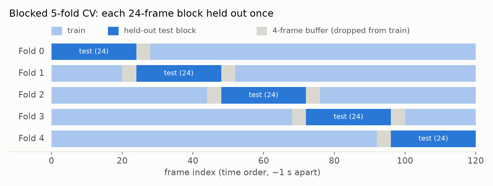
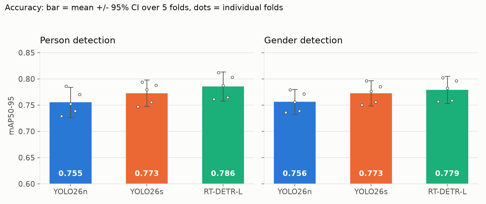
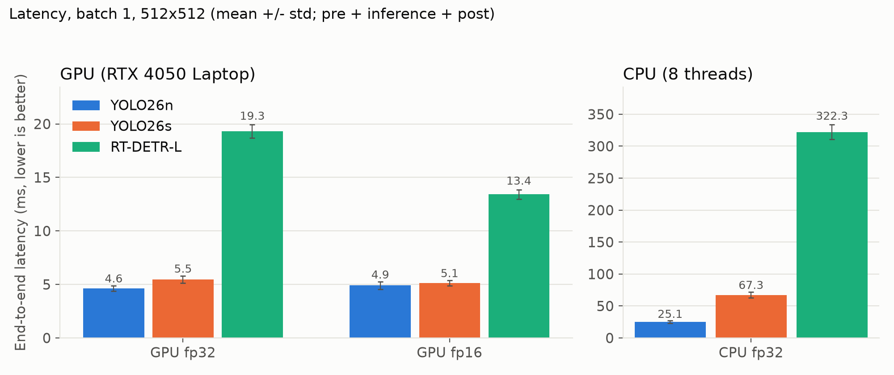
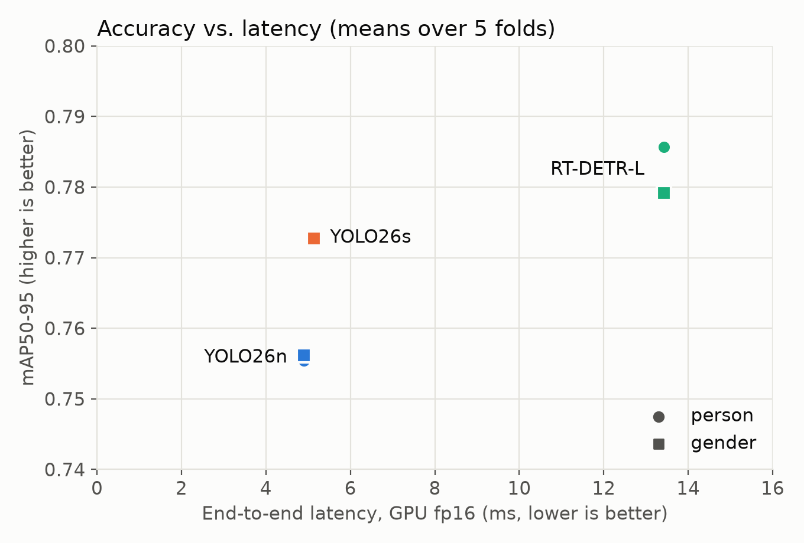
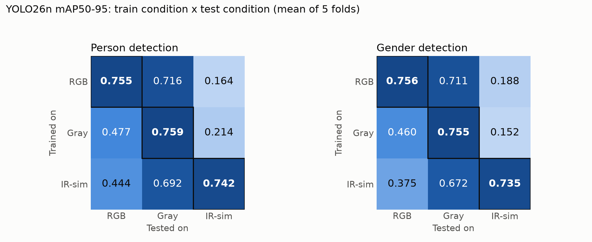

# AITF CCTV Intelligence: benchmark data for slides

Models: YOLO26n, YOLO26s, RT-DETR-L. Tasks: person detection and gender detection. Accuracy and latency.
All numbers come from `results/` (`summary.csv`, `paired_diffs.csv`, `latency.json`, `runs/*.json`).

---

## 0. Plain-language guide (for slide notes)

| Term | Meaning |
|---|---|
| **Person detection** | Find every person in the frame and draw a box around them. |
| **Gender detection** | Same, but each box is labelled Female or Male (one model does both jobs). |
| **IoU** | Overlap between a predicted box and the true box (0 = none, 1 = perfect). |
| **mAP50** | Average precision when a box counts as correct if IoU >= 0.5 (a "roughly right place" score). |
| **mAP50-95** | Average of the score over IoU thresholds 0.5 to 0.95, so it also rewards tight, accurate boxes. Stricter, and the main metric in this deck. |
| **Fold / blocked CV** | The 120 frames are cut into 5 time blocks. Each block is used once as the unseen test set while the model trains on the others. |
| **Buffer** | Frames next to the test block are dropped from training, because neighbouring frames look almost identical. |
| **95% CI (error bar)** | Range that the true mean likely falls in. Wide bars mean the result depends on which fold you look at. |
| **Paired difference** | Compare two models fold by fold and average the gaps. It removes "some folds are just harder" noise, so it is more sensitive than comparing two error bars. |
| **Latency (ms)** | Time to process one frame. Lower is better. 5 ms is about 200 frames per second. |
| **End-to-end vs model-only** | End-to-end includes resizing the image and cleaning up the predictions. Model-only is just the neural network. |
| **fp32 / fp16** | 32-bit vs 16-bit number precision. fp16 is often faster on GPU. |
| **RGB / Gray / IR-sim** | Normal colour frames / black-and-white frames / black-and-white plus dim, vignetted, blurry and noisy, imitating an infrared camera. |

---

## 1. Methodology

### 1.1 Goal
Compare three detectors on classroom CCTV frames for two tasks, on both accuracy and latency.
- **Person detection**: 1 class (every box merged into `person`).
- **Gender detection**: 2-class detector (`female`, `male`). It is joint detection plus gender classification, not a separate crop classifier (RT-DETR has no classification-only variant).
- "Student" is not a class in the data. Everyone in the room is a student, so the task is really person detection plus gender labels.

### 1.2 Dataset (Roboflow export `AITF.v1i.yolo26`, CC BY 4.0)
- 120 frames, all from **one** classroom CCTV clip (~2 min, frames ~1 s apart), resized to 512x512 (stretch).
- 3,766 boxes after cleaning: **2,114 Female**, **1,652 Male** (about 31 boxes per frame).
- Original random split: train 73 / valid 35 / test 12 frames. It leaks near-duplicate neighbouring frames, so it was **not used**.

*Slide use: shows what the data looks like. Ceiling-mounted classroom camera, dense overlapping students, boxes labelled Female (orange) and Male (blue). Note how the Female boxes cover the students in white hijabs.*

### 1.3 Dataset audit and fixes
| Issue found | Action |
|---|---|
| Stray third class `AITF` (15 boxes in only 3 frames). Rendering the boxes showed it was a labelling error: 13 boxes on boys (train frame 10) and 1 box each on a hijab-wearing girl (valid frame 20, test frame 35). | Relabelled to `Male` (train frame 10) and `Female` (valid frame 20, test frame 35). |
| 119 labels were polygons (118 four-point, 1 with 23 points) mixed in with boxes. | Converted to enclosing axis-aligned boxes. |
| Random split puts frames ~1 s apart in both train and test. | Replaced by blocked time-based CV (below). |
| README says 3 augmented versions per image, but only 120 images were exported. | No augmentation copies present. Only Ultralytics' standard on-the-fly augmentation was used. |

### 1.4 Evaluation protocol (leakage-aware)
- All 120 frames merged and sorted in time order, then split into **5 contiguous blocks of 24 frames**.
- Each block is held out once as the test fold. A **4-frame buffer** on both sides of the block is removed from training.
- Train sizes: 92 / 88 / 88 / 88 / 92 frames. Test size: 24 frames per fold.
- No validation set and no checkpoint selection: the **final-epoch weights** are evaluated on the held-out block. Nothing is tuned on test data.
- Metrics:
  - **mAP50** and **mAP50-95** (threshold-free), from Ultralytics.
  - **Matched gender accuracy**: predictions with conf >= 0.25 (fixed in advance, not tuned) are matched to ground truth at IoU >= 0.5 (class-agnostic), then scored for the correct gender.
  - Precision, recall and F1 are deliberately not reported, since Ultralytics computes them at a threshold chosen on the evaluation data (leakage).
- Statistics: results are averaged over seeds within each fold, then mean and **95% t-distribution CI over the 5 folds**. Model comparisons are **paired per fold** (fold-to-fold difficulty is large, so unpaired CIs are too wide).

*Slide use: explains why the original random split was replaced. Dark blue = the 24 unseen test frames, light blue = training frames, gray = buffer frames removed so the model never trains on near-copies of test frames.*

### 1.5 Training setup
- COCO-pretrained weights, fine-tuned: `yolo26n`, `yolo26s`, `rtdetr-l` (Ultralytics 8.4.165, PyTorch 2.14, CUDA).
- 100 epochs, image size 512, batch 8, AMP, Ultralytics default optimiser and augmentation, deterministic mode.
- 3 seeds (0, 1, 2) x 5 folds x 2 tasks x 3 models = 90 planned runs. **86 completed**: four RT-DETR-L runs (fold 4 seed 1 and fold 0 seed 2, both tasks) ran out of GPU memory every time on the 6 GB card and were left out rather than changing their batch size. Every fold still has at least 2 seeds per model.
  - Runs per cell: YOLO26n 15, YOLO26s 15, RT-DETR-L 13 (per task).
- Hardware: NVIDIA RTX 4050 Laptop GPU (6 GB), 20-thread CPU.

### 1.6 Latency protocol
- Batch 1, 512x512 input, conv+BN fused (as `predict()` does), `torch.inference_mode`.
- Warmup: 50 iterations on GPU, 5 on CPU. Timed: 300 iterations on GPU, 40 on CPU. GPU timing synchronised with `cuda.synchronize`.
- Two measurements: **model-only** (forward pass) and **end-to-end** (preprocessing + forward pass + postprocessing, via `predict()` at conf 0.25).
- Settings: GPU fp32, GPU fp16, CPU fp32 (8 threads).
- Weights used: fold 0, seed 0 gender models (latency does not depend on the weights except through postprocessing).
- A first run had an unfused model-only path that made model-only slower than end-to-end. It was fixed and rerun. The numbers below are from the fixed run.

---

## 2. Results

### 2.1 Accuracy (mean +/- 95% CI over 5 held-out folds)

| Task | Model | mAP50 | mAP50-95 | Gender acc. (matched, conf 0.25) | Runs |
|---|---|---|---|---|---|
| Person | YOLO26n | 0.987 +/- 0.006 | 0.755 +/- 0.029 | n/a | 15 |
| Person | YOLO26s | 0.990 +/- 0.003 | 0.773 +/- 0.025 | n/a | 15 |
| Person | RT-DETR-L | 0.989 +/- 0.006 | 0.786 +/- 0.028 | n/a | 13 |
| Gender | YOLO26n | 0.982 +/- 0.005 | 0.756 +/- 0.024 | 0.992 +/- 0.006 | 15 |
| Gender | YOLO26s | 0.986 +/- 0.006 | 0.773 +/- 0.024 | 0.992 +/- 0.005 | 15 |
| Gender | RT-DETR-L | 0.986 +/- 0.007 | 0.779 +/- 0.026 | 0.991 +/- 0.007 | 13 |

*Slide use: bar = mean over 5 folds, error bar = 95% CI, white dots = each fold. The bars overlap because folds differ in difficulty, but the dots show the ranking RT-DETR-L > YOLO26s > YOLO26n is the same in each fold (see paired table below).*

### 2.2 Paired per-fold differences in mAP50-95 (mean difference +/- 95% CI, n = 5 folds)

| Task | Comparison | Difference | CI +/- |
|---|---|---|---|
| Person | YOLO26s - YOLO26n | +0.017 | 0.008 |
| Person | RT-DETR-L - YOLO26n | +0.030 | 0.005 |
| Person | RT-DETR-L - YOLO26s | +0.013 | 0.005 |
| Gender | YOLO26s - YOLO26n | +0.017 | 0.003 |
| Gender | RT-DETR-L - YOLO26n | +0.023 | 0.003 |
| Gender | RT-DETR-L - YOLO26s | +0.006 | 0.004 |

All intervals exclude zero, so the ordering RT-DETR-L > YOLO26s > YOLO26n is consistent across folds. The gaps are small (0.006-0.030 mAP50-95). With 5 folds from one clip, treat this as a consistent trend, not a proven significant effect.

### 2.3 Per-fold mAP50-95 (seed-averaged)

| Task | Model | Fold 0 | Fold 1 | Fold 2 | Fold 3 | Fold 4 |
|---|---|---|---|---|---|---|
| Person | YOLO26n | 0.729 | 0.786 | 0.752 | 0.739 | 0.770 |
| Person | YOLO26s | 0.747 | 0.794 | 0.779 | 0.755 | 0.788 |
| Person | RT-DETR-L | 0.762 | 0.812 | 0.787 | 0.765 | 0.803 |
| Gender | YOLO26n | 0.736 | 0.779 | 0.756 | 0.739 | 0.771 |
| Gender | YOLO26s | 0.750 | 0.796 | 0.776 | 0.756 | 0.785 |
| Gender | RT-DETR-L | 0.757 | 0.802 | 0.782 | 0.759 | 0.796 |

Fold difficulty varies more than model differences (fold 1 is easiest for every model, fold 0 hardest). The ranking is the same in every fold.

### 2.4 Per-class mAP50-95 in the gender task (mean over runs)

| Model | Female | Male |
|---|---|---|
| YOLO26n | 0.778 | 0.735 |
| YOLO26s | 0.796 | 0.750 |
| RT-DETR-L | 0.807 | 0.752 |

Female is easier than Male for all models. Female has about 28% more boxes.

### 2.5 Model complexity and training cost

| Model | Params (M) | GFLOPs (512x512) | Train time per run (min, 100 epochs) |
|---|---|---|---|
| YOLO26n | 2.5 | 3.7 | 1.6 |
| YOLO26s | 9.9 | 14.5 | 2.6 |
| RT-DETR-L | 32.8 | 72.1 | 8.9 |

### 2.6 Latency, batch 1, 512x512 (RTX 4050 Laptop GPU; mean ms, p95 in brackets)

**End-to-end (preprocess + inference + postprocess)**

| Model | GPU fp32 | GPU fp16 | CPU fp32 | FPS (GPU fp16) | FPS (CPU) |
|---|---|---|---|---|---|
| YOLO26n | 4.63 (5.01) | 4.90 (5.55) | 25.07 (27.33) | 204 | 39.9 |
| YOLO26s | 5.46 (5.83) | 5.13 (5.56) | 67.31 (74.83) | 195 | 14.9 |
| RT-DETR-L | 19.30 (20.04) | 13.43 (14.02) | 322.31 (335.93) | 74.5 | 3.1 |

**Model-only (forward pass)**

| Model | GPU fp32 | GPU fp16 | CPU fp32 |
|---|---|---|---|
| YOLO26n | 3.22 (3.53) | 3.30 (3.63) | 24.98 (26.34) |
| YOLO26s | 4.22 (4.63) | 3.44 (3.68) | 75.02 (84.24) |
| RT-DETR-L | 18.16 (18.88) | 12.28 (12.96) | 353.64 (371.77) |

**Peak GPU memory (fp16 run):** YOLO26n 68 MB, YOLO26s 166 MB, RT-DETR-L 406 MB.

Latency ratios versus YOLO26n (end-to-end):
- RT-DETR-L is about 4.2x slower on GPU fp32 (19.3 vs 4.6 ms) and about 12.9x slower on CPU (322 vs 25 ms).
- YOLO26s is about 1.2x slower on GPU fp32 and about 2.7x slower on CPU.

*Slide use: end-to-end latency on GPU (fp32, fp16) and CPU. RT-DETR-L is about 3.5-4.2x slower than the YOLO26 models on GPU fp32 (about 2.6-2.7x on fp16) and about 13x slower than YOLO26n on CPU.*

*Slide use: the trade-off in one picture. Circles = person task, squares = gender task. Up = more accurate, left = faster. YOLO26s sits in the sweet spot: near YOLO26n's speed with a clear accuracy gain. RT-DETR-L is the most accurate but 2.6x slower than YOLO26s on GPU fp16 (13.4 vs 5.1 ms). Error bars are omitted here on purpose, because fold difficulty makes unpaired intervals misleading; use the paired table in 2.2.*

### 2.7 Accuracy vs. cost, key takeaways
- **Accuracy:** RT-DETR-L > YOLO26s > YOLO26n on mAP50-95 in every fold and both tasks, but by small margins (about 0.01-0.03). mAP50 is essentially tied (0.982-0.990), and matched gender accuracy is tied (about 0.99).
- **Cost:** RT-DETR-L buys about +0.030 (person) and +0.023 (gender) mAP50-95 over YOLO26n at 4x (GPU) to 13x (CPU) the latency, 13x the parameters and about 20x the FLOPs.
- **Trade-off:** YOLO26s recovers about 57% of RT-DETR-L's person gain over YOLO26n (0.017 of 0.030) and about 74% of its gender gain (0.017 of 0.023), at about GPU-equal latency (5.5 vs 4.6 ms; 2.7x on CPU). It is the balanced choice for GPU deployment. YOLO26n is the choice for CPU or edge use. RT-DETR-L only makes sense if the last 0.01-0.03 mAP50-95 matters more than throughput.
- **GPU timing caveat:** YOLO26n and YOLO26s are close on GPU because such small models are limited by kernel-launch overhead, not compute. CPU numbers reflect real compute cost better. RT-DETR-L's fp16 speedup (19.3 to 13.4 ms) is much larger than the YOLO26 models' (little or none).
- **Small CPU inconsistency:** YOLO26s and RT-DETR-L show model-only CPU time above end-to-end time. It is thread-scheduling noise on 40 timed iterations, and the differences are within a few standard deviations. Treat CPU numbers as approximate.

---

## 3. Limitations and threats to validity
- **One scene, one clip, the same students in every fold.** Blocked CV measures generalisation across time in that room, not to new rooms, cameras, lighting or seating. Real-world accuracy is likely lower.
- **The gender labels appear to track attire (hijab vs no hijab).** In every frame rendered, `Female` matched the students wearing white hijabs. The ~0.99 gender accuracy therefore probably reflects hijab detection, not gender recognition. Do not present it as real gender recognition.
- **Small data.** 120 frames, 24 per test fold, 5 folds. CIs are wide, and the paired ranking is a trend, not a proven effect.
- **Overlapping boxes.** Some ground-truth boxes cover several overlapping students (dense classroom), which caps mAP50-95.
- **Missing runs.** 4 of 90 RT-DETR-L runs are absent (GPU out of memory), so RT-DETR-L has 13 runs per task versus 15 for the YOLO26 models.
- **Latency is on a laptop GPU** that can thermally throttle. Only one hardware setup was tested, and no TensorRT/ONNX export was benchmarked.
- **Only RT-DETR-L** was tested (Ultralytics ships no smaller RT-DETR), so the RT-DETR vs YOLO26 comparison is across different size classes.

---

## 4. Suggested slide flow (13 slides)

| # | Slide | Content | Figure |
|---|---|---|---|
| 1 | Title and goal | Person and gender detection in classroom CCTV; YOLO26n / YOLO26s / RT-DETR-L; accuracy AND latency; plus an infrared-simulation test | none |
| 2 | Dataset and audit | 120 frames, one clip, 3,766 boxes; fixes applied (stray `AITF` class, polygons to boxes); "student" is not a class | `01_dataset_example.png` |
| 3 | Evaluation protocol | Why the random split leaked; blocked 5-fold CV with buffers; no test-set tuning; metrics chosen to avoid leakage | `02_blocked_cv.png` |
| 4 | Setup | Models, training (100 epochs, 512 px, 3 seeds), latency protocol, hardware | none (small table) |
| 5 | Accuracy results | Table 2.1 and bar chart | `06_accuracy_bars.png` |
| 6 | Are the differences real? | Paired differences (2.2) and per-fold consistency (2.3) | table |
| 7 | Gender task detail | Per-class AP (2.4), matched gender accuracy ~0.99 and why to be sceptical (hijab) | table |
| 8 | Latency and cost | Params, GFLOPs, latency tables 2.5 and 2.6 | `07_latency_bars.png` |
| 9 | Accuracy vs. latency | Trade-off and recommendation (2.7) | `08_accuracy_vs_latency.png` |
| 10 | Extra: infrared simulation, setup | Why, three conditions, how IR-sim is built | `03_ir_examples.png`, `04_ir_degradation_steps.png` |
| 11 | Infrared results | 3x3 train x test matrix | `05_ir_heatmap.png` |
| 12 | Infrared takeaways | Takeaways 5.5 and the paired table 5.4 | table |
| 13 | Limitations and next steps | Section 3 plus 5.6; next: real IR footage, multi-room data, attire-independent gender labels, mixed RGB+IR training, TensorRT export | none |

---

## 5. Extra experiment: simulated infrared CCTV (YOLO26n)

### 5.1 Question and method
Can the detector cope with infrared-style CCTV? No real infrared footage is available, so infrared was **simulated** from the RGB frames. This is a proxy, not real infrared (see 5.5).
- **Model:** YOLO26n only (same setup as section 1.5: 100 epochs, 512 px, batch 8, COCO-pretrained), both tasks (person, gender).
- **Protocol:** the same blocked 5-fold splits as section 1.4, so numbers are directly comparable to the RGB benchmark. 3 seeds x 5 folds x 2 tasks = 30 jobs, each training three models. All 30 jobs completed.
- **Three image conditions** (labels and splits identical):
  - **RGB**: original frames.
  - **Gray**: luminance only, replicated to 3 channels (keeps the pretrained input shape).
  - **IR-sim**: Gray, then dynamic range compressed to 0.15-0.85, radial vignette (up to ~35% darker at corners), Gaussian blur (sigma 0.8 px), Gaussian sensor noise (sigma 0.04 of full scale). Fixed per frame (seeded), so train and test see the same fixed degradation.
- **Train x test matrix:** each condition is used for training, and every trained model is evaluated on the held-out block in all three conditions (final-epoch weights, no selection).
- Statistics as before: seed-averaged per fold, mean and 95% t-CI over 5 folds, and paired per-fold differences.

*Slide use: the core visual for this experiment. An RGB-trained model barely notices the loss of colour (0.755 to 0.716) but collapses on the dim, noisy IR-sim frame (0.164).*

*Slide use: transparency about the simulation. Five cumulative steps: grayscale, compressed contrast (0.15-0.85), radial vignette, Gaussian blur (sigma 0.8 px), Gaussian sensor noise (sigma 0.04).*

### 5.2 Results: mAP50-95 (rows = training condition, columns = test condition)

**Person detection**

| Train \ Test | RGB | Gray | IR-sim |
|---|---|---|---|
| RGB | **0.755** | 0.716 | 0.164 |
| Gray | 0.477 | **0.759** | 0.214 |
| IR-sim | 0.444 | 0.692 | **0.742** |

**Gender detection**

| Train \ Test | RGB | Gray | IR-sim |
|---|---|---|---|
| RGB | **0.756** | 0.711 | 0.188 |
| Gray | 0.460 | **0.755** | 0.152 |
| IR-sim | 0.375 | 0.672 | **0.735** |

*How to read it: each row is what the model was trained on, each column is what it was tested on. The outlined diagonal is "trained and tested on the same kind of image" and is uniformly dark (0.735-0.759 = good). The pale IR-sim column in the RGB and Gray rows shows models that never saw infrared-like images failing on them. The IR-sim row shows a model trained on infrared-like images: strong on IR-sim and Gray, weaker on RGB.*

### 5.3 Results: mAP50

| Task | Train \ Test | RGB | Gray | IR-sim |
|---|---|---|---|---|
| Person | RGB | 0.987 | 0.983 | 0.362 |
| Person | Gray | 0.810 | 0.988 | 0.396 |
| Person | IR-sim | 0.807 | 0.973 | 0.980 |
| Gender | RGB | 0.982 | 0.976 | 0.360 |
| Gender | Gray | 0.797 | 0.980 | 0.258 |
| Gender | IR-sim | 0.711 | 0.951 | 0.972 |

(95% CIs for every cell are in `results/ir_summary.csv`.)

### 5.4 Paired per-fold differences in mAP50-95 (A minus B, mean +/- 95% CI, n = 5 folds; "+" folds = folds where A > B)

| Task | A (train, test) | B (train, test) | Difference | CI +/- | Folds A > B |
|---|---|---|---|---|---|
| Person | RGB, RGB | RGB, Gray | +0.040 | 0.010 | 5/5 |
| Person | RGB, RGB | RGB, IR-sim | +0.591 | 0.028 | 5/5 |
| Person | Gray, Gray | RGB, Gray | +0.043 | 0.013 | 5/5 |
| Person | IR-sim, IR-sim | RGB, IR-sim | +0.577 | 0.025 | 5/5 |
| Person | Gray, Gray | RGB, RGB | +0.004 | 0.009 | 3/5 |
| Person | IR-sim, IR-sim | RGB, RGB | -0.014 | 0.007 | 0/5 |
| Person | IR-sim, IR-sim | Gray, Gray | -0.017 | 0.007 | 0/5 |
| Gender | RGB, RGB | RGB, Gray | +0.045 | 0.018 | 5/5 |
| Gender | RGB, RGB | RGB, IR-sim | +0.569 | 0.059 | 5/5 |
| Gender | Gray, Gray | RGB, Gray | +0.044 | 0.019 | 5/5 |
| Gender | IR-sim, IR-sim | RGB, IR-sim | +0.548 | 0.058 | 5/5 |
| Gender | IR-sim, IR-sim | RGB, RGB | -0.021 | 0.005 | 0/5 |
| Gender | Gray, Gray | RGB, RGB | -0.002 | 0.009 | 2/5 |
| Gender | IR-sim, IR-sim | Gray, Gray | -0.019 | 0.009 | 0/5 |

### 5.5 Takeaways
1. **Losing colour alone is nearly harmless.** An RGB-trained model tested on grayscale drops only about 0.04 mAP50-95 (0.755 to 0.716 person, 0.756 to 0.711 gender), with mAP50 essentially unchanged (0.987 to 0.983). Grayscale-trained models are on par with RGB-trained ones on their own images (person +0.004, gender -0.002; not distinguishable).
2. **Degraded IR-like frames break an RGB-trained model.** Tested on IR-sim, the RGB-trained model falls from 0.755 to 0.164 (person) and 0.756 to 0.188 (gender) mAP50-95, and mAP50 to about 0.36. Grayscale training does not fix this (0.214 person, 0.152 gender). So the problem is the low contrast, darkness and noise, not the missing colour.
3. **Training on IR-sim recovers almost everything.** IR-sim-trained models reach 0.742 (person) and 0.735 (gender) on IR-sim test frames, and mAP50 0.980 / 0.972. That is only 0.014 (person) and 0.021 (gender) below the RGB baseline, and consistent across all 5 folds. Infrared-style degradation costs a small amount of accuracy once the model has seen it in training.
4. **Cross-domain transfer is asymmetric.** IR-sim-trained models still do reasonably on plain grayscale (0.692 person, 0.672 gender), but poorly on RGB (0.444, 0.375). Gray-trained models also fall on RGB (0.477, 0.460), so a colour input to a model trained only on gray is a domain shift.
5. **Practical implication:** an RGB-only model should not be deployed on infrared cameras. A model trained with infrared-like images works well in the simulation. If both day (RGB) and night (infrared) cameras are needed, train on a mix of RGB and infrared-like images. This mix was **not** tested here.

### 5.6 Limitations of this experiment
- **Simulation only.** Real near-infrared changes how fabric, skin and hair reflect light (batik vests and hijabs may not keep their RGB contrast), and real IR cameras have their own noise, IR-LED hotspots and lower resolution. Results show robustness to grayscale plus low contrast, vignette, blur and noise, and cannot be claimed as real infrared performance. Real IR frames are needed to validate.
- **The degradation parameters were chosen by hand** and not tuned to any real camera. Results depend on their severity (a worse or milder setting would move the IR-sim numbers).
- **Same scene and students in every fold**, and the gender task probably relies on hijab appearance (see section 3), which grayscale mostly preserves (white hijab stays bright). Gender accuracy on truly infrared footage could be worse than these numbers suggest.
- **YOLO26n only.** YOLO26s and RT-DETR-L were not tested. A mixed RGB+infrared training set, real IR data and an infrared-specific latency benchmark were not run.
- Matched gender accuracy at a fixed threshold was not computed for this experiment (mAP only).

### 5.7 Suggested extra slides
- Slide A: simulation examples, side by side (RGB / Gray / IR-sim), from `data/ir_images/`.
- Slide B: 3x3 train x test heatmap (mAP50-95) for each task. This is the main figure.
- Slide C: takeaways 1-5 and the "simulation only" caveat.

Files: `results/ir_summary.csv`, `results/ir_paired.csv`, `results/ir/*.json`, `src/prep_ir.py`, `src/ir_eval.py`, `src/aggregate_ir.py`.

---

## 6. Figure index (all in `results/fig_ppt/`, PNG at 200 dpi, generated by `src/make_figures.py`)

| File | Shows |
|---|---|
| `01_dataset_example.png` | One annotated frame (Female orange, Male blue) |
| `02_blocked_cv.png` | Blocked 5-fold CV with buffers |
| `03_ir_examples.png` | Same frame as RGB, Gray and IR-sim, with the RGB-trained model's score on each |
| `04_ir_degradation_steps.png` | The five steps that build IR-sim |
| `05_ir_heatmap.png` | Train x test mAP50-95 matrix, person and gender |
| `06_accuracy_bars.png` | mAP50-95 per model, CI and per-fold dots |
| `07_latency_bars.png` | End-to-end latency, GPU fp32/fp16 and CPU |
| `08_accuracy_vs_latency.png` | Accuracy vs. GPU fp16 latency |

Colours: blue, orange and aqua identify YOLO26n, YOLO26s and RT-DETR-L consistently across figures; in the dataset figure orange/blue mean Female/Male instead. Heatmaps use a single blue ramp (darker = higher mAP).
